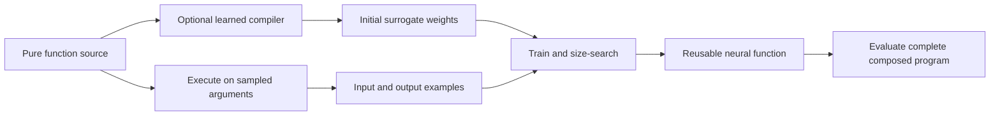

# Can high-level pure functions become efficient approximate neural modules?

## Question and assessment

The user proposes starting from ordinary high-level code with limited memory, pure functions, loops and structured data, then producing a network or composition of networks. One network per function is an initial idea, and the transformation may be lossy.

This is a researched direction, usually called neural surrogates of programs, surrogate compilation or neural acceleration. It can avoid reproducing the original program's internal operations by learning the input/output behavior of an entire function or region. Our assessment: a promising way to explore practical accuracy/size tradeoffs, but purity, finite memory and modularity alone do not guarantee compact models, easy training or speedups.

Bounded storage corresponds to a finite machine when all stored values have finite domains, including call-stack/control state. Bounded memory does not imply termination or a bounded number of loop iterations. A pure function has no hidden inter-call state; a stream-processing machine can expose state explicitly as `(next_state, output) = step(state, input)`.

## The closest research

| Work | What it does | Match to the proposal |
| --- | --- | --- |
| [Parrot / Neural Acceleration, MICRO 2012](../sources/parrot-neural-acceleration.md) | Instruments functions, collects examples, trains/searches MLPs and replaces calls | Very close: pure functions, fixed-size interfaces, loops/calls inside candidate regions |
| [Programming with Neural Surrogates, Onward! 2021](../sources/neural-surrogate-programming.md) | Defines compilation, adaptation and optimization workflows | Supplies the terminology and broader methodology |
| [Turaco, OOPSLA 2023](../sources/turaco-complexity-guided-sampling.md) | Allocates samples using path frequency and learning complexity; separate models per stratum | Uses source structure to improve training, rather than treating code only as an input/output oracle |
| [Learning to Compile Programs to Neural Networks, 2024](../sources/compnet-neural-surrogate-compilation.md) | CompNet reads C source and generates surrogate weights; then fine-tunes from executions | Directly studies a learned source-to-neural transformation |
| [Compiling to Linear Neurons / Cajal, POPL 2026](../sources/cajal-compiling-to-linear-neurons.md) | Compiles a restricted typed functional language and links its neurons with learned components | An adjacent hybrid route; more restrictions than purity, and not wholly lossy function replacement |

Parrot's sections 3–4 are particularly relevant. The annotation identifies entire functions with fixed-size inputs and outputs. Its workflow logs argument/return values, searches neural topologies and trains weights. The source permits calls, loops and complex control flow inside an approximated function. Its illustrated Sobel surrogate is described as a 9-input, 8-hidden-unit, 1-output model; this does not mirror the original source structure. Runtime and energy claims depend on its NPU design and benchmarks. We have not reproduced them.

CompNet's sections 2–4 separate source processing from surrogate execution: a BERT-based hypernetwork produces parameters for a small target architecture. The source supplies a useful initialization, followed by fine-tuning where required. The covered evaluation uses deterministic, pointer-free numeric C functions and small sigmoid MLPs. Its evidence concerns prediction error and the cost of developing a surrogate; it does not prove a universal efficient mapping or minimum connection count.

## Two ways to perform the transformation

The following is our synthesis of the sources, not an implemented project pipeline.

**Per-program training:** treat a function as an executable teacher; encode its arguments and return values; collect representative `(input, output)` examples; train and size-search a model; replace its call sites. You need no differentiable source program to do supervised fitting.

**Learned compiler:** train a source-conditioned model over many programs to generate the initial weights of a target network. For a new function, encode its source, produce parameters, and optionally fine-tune using executions. This amortizes some preparation across functions, but requires upfront training data and a supported source/model family. CompNet is an example.

## What happens to functions, loops and data?

One network per function preserves an understandable interface and lets call sites share a reusable model. Several functions can instead be fused into one surrogate to remove intermediate representations or invocation overhead. A tiny function may be cheaper to execute directly than to approximate with a dense network. The best partition depends on workload and target hardware; source boundaries are useful candidates, not a size theorem.

For `g(f(x))`, the modular replacement is `N_g(N_f(x))`. Training `N_g` only on exact outputs of `f` can leave it unprepared for the perturbed outputs of `N_f`. Evaluate the composition, include examples from approximate upstream executions, or consider joint fine-tuning. If interfaces include discrete decisions, validate their consequences rather than relying only on numeric mean squared error.

There are three loop choices:

1. Preserve the loop and approximate its body. Reuse the same model each iteration.
2. Approximate the complete loop's final input/output mapping with one model. A feedforward surrogate need not reproduce intermediate iterations.
3. Use a recurrent neural module to model state updates, with shared weights across steps. Specify a step or sequence horizon and assess accumulated error.

The second choice can bypass substantial computation when the resulting function is learnable with a small model. It does not guarantee that every long computation has a compact approximation.

For data, fixed-size numeric tuples/arrays can be encoded as vectors. Enums, bits, structured outputs and variable-length containers need explicit encodings and decoding rules. Padding/masks or specialized architectures are possible design choices. Purity does not make all types naturally compatible with an MLP. Retain the original explicit state representation in the first experiment; learning a compressed hidden state is a separate modeling decision.

## Why local accuracy may fail globally

An original illustrative counterexample: let the downstream program return 0 if an intermediate scalar is nonpositive, and 1000 otherwise. Changing a value from $-0.0001$ to $+0.0001$ gives a tiny numeric intermediate error but a final error of 1000. Keeping the comparator exact does not prevent this if its input is approximated.

For a continuous recurrent update $F$, suppose $F$ is $L$-Lipschitz in the state and the surrogate has uniform one-step error at most $\epsilon$ throughout the region reached by both systems. Our elementary derivation gives

$$e_{t+1}\leq L e_t+\epsilon.$$

Repeated steps can amplify error when $L>1$, accumulate it when $L=1$, or limit it when $L<1$. These assumptions need not hold for discrete branch/state updates or for regions unseen in training. A held-out one-step average loss alone gives no such sequence guarantee.

Turaco makes source-path structure useful here: it retains the branch conditions that select separate path surrogates, and uses path-specific complexity to guide sampling. This is a concrete researched partitioning strategy. It does not eliminate downstream errors caused by approximate values flowing into later branches. [Sections 1.3 and 2](../sources/turaco-complexity-guided-sampling.md).

## A better objective for this version of the problem

Our proposed formulation is to minimize the deployed modules' connection count subject to a whole-program quality target:

$$\min \operatorname{connections}(\widehat P)
\quad\text{subject to}\quad
\mathbb{E}_{x\sim D}\left[\ell(P(x),\widehat P(x))\right]\leq\varepsilon.$$

Here $D$ is the workload distribution and $\ell$ is the application loss. For streaming behavior, $x$ should describe a complete input sequence and initial state, with a declared horizon. Average quality, worst-case error and probability of a wrong discrete decision are different contracts.

Count nonzero weighted connections in the actual deployed architecture, excluding biases under the existing convention. A single reusable module retains the same stored network across calls. A static graph that copies modules can have more connections even when weights are tied; unique parameter counts and executed operations are separate metrics. Report runtime, memory traffic and training/data cost alongside size. Small dense surrogates can still lose against a few native instructions.

Since complete equivalence is relaxed, minimum DFA state count is no longer the principal size predictor. The distribution, tolerated error, program structure and chosen architecture jointly define the new question. See the [earlier exact-size analysis](fsm-size-vs-synapses.md) for the different contract.

Allowing loss does not establish that training is universally the most efficient conversion method. It may find a compact useful surrogate, while an exact structural construction may already be smaller or cheaper. Training does not guarantee a minimum connection count, and low observed loss alone does not certify exact equivalence. See the [corrected recap](efficient-methods-and-matrix-mapping.md) and [complexity distinctions](../concepts/complexity-limits.md).

## Proposed experiment and limits

Start with a small pure function with explicit bounded numeric inputs and a meaningful error metric. Compare its original execution, a per-function small MLP and a model of a fused region or whole loop. Generate labels with the original program, include branch boundaries and representative workloads, and validate complete composed runs on separately held-out inputs/sequences. Preserve an exact original runner for comparison.

This is a proposed experiment, not a compiler implementation or demonstrated speedup. Source reviews are first-pass; later proofs and most experimental details remain unaudited. No model has been trained for this project.

## Related pages

- [Neural surrogate compilation](../concepts/neural-surrogate-compilation.md)
- [Construction, learning and extraction](../concepts/learning-vs-construction.md)
- [Efficient methods and matrix mapping](efficient-methods-and-matrix-mapping.md)
- [Research roadmap](research-roadmap.md)
